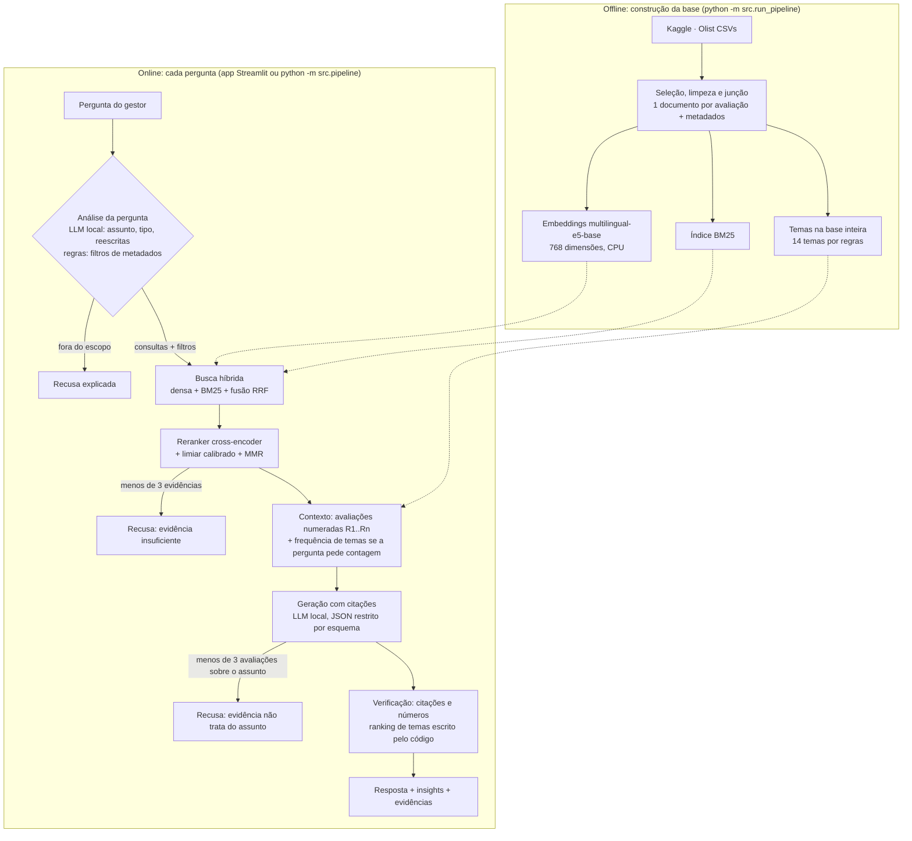
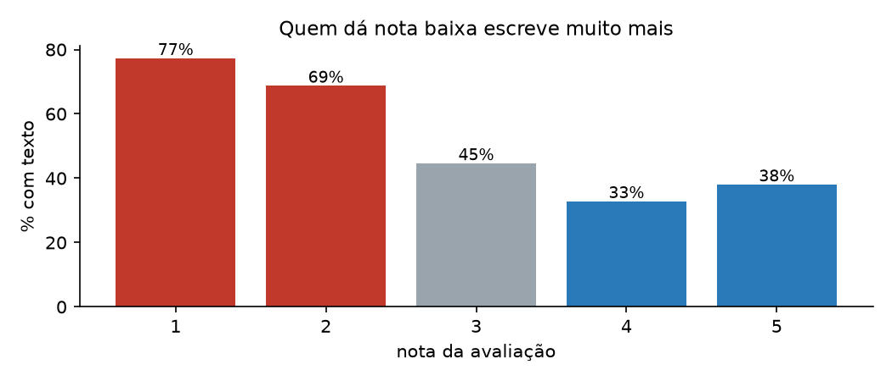
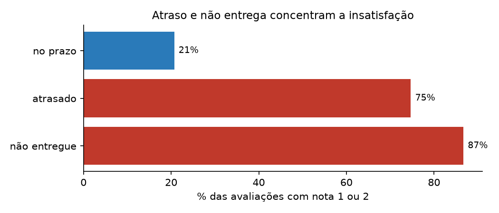
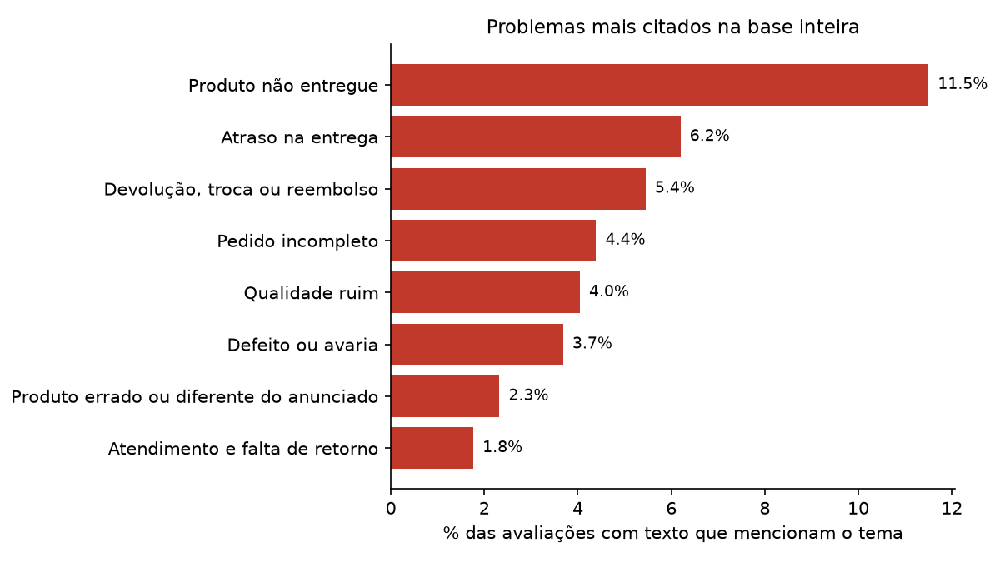
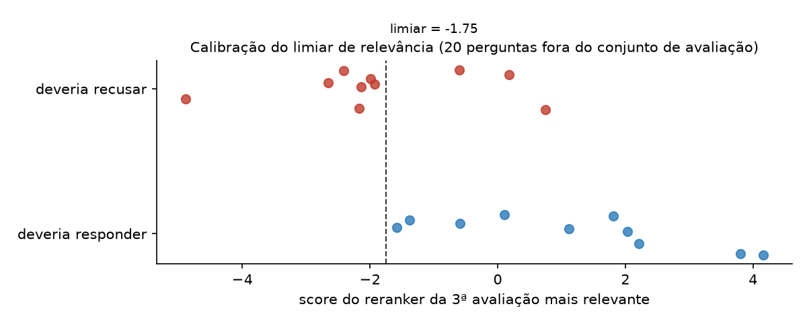

# Voz do Cliente: RAG sobre avaliações da Olist

Gestores perguntam em linguagem natural ("quais reclamações de entrega aparecem com maior frequência?") e recebem uma resposta **fundamentada nas avaliações reais dos clientes**, com cada afirmação apontando as avaliações que a sustentam. Quando a base não tem evidência suficiente, ou a pergunta está fora do escopo, o sistema diz isso em vez de inventar.

Tech Challenge da Fase 4 da pós em IA (FIAP). Base: [Brazilian E-Commerce Public Dataset by Olist](https://www.kaggle.com/datasets/olistbr/brazilian-ecommerce), cerca de 100 mil pedidos de 2016 a 2018.

**Resultados principais**

- **36.038 avaliações** viram documentos pesquisáveis, cada uma com nota, período, categoria e status da entrega.
- **Recusa honesta:** com o LLM, responde as 30 perguntas que deveria responder e recusa as 11 fora do escopo ou sem evidência (100% nas três medidas). Sem o LLM, responde 29 de 30. Detalhes na [seção 9](#9-avaliação).
- **Frequência de verdade:** "principais problemas" é contado nas 36 mil avaliações, não nas 15 recuperadas. Com nota 1 ou 2, *produto não entregue* aparece em 32,6% dos textos.
- **Custo zero:** o LLM roda localmente (Qwen2.5 7B via [Ollama](https://ollama.com)), sem chave nem cobrança por pergunta. Busca e índice rodam em CPU; não precisa de conta no Kaggle.
- **Recuperação:** precisão@10 de 0,82 no pipeline completo, contra 0,61 da busca só densa. Nas perguntas com recorte de metadados, 0,86 contra 0,49.
- **Fidelidade:** 85% dos 142 insights gerados são sustentados pelas avaliações que citam, segundo o juiz LLM. Nenhuma das 745 citações aponta para uma avaliação que não estava no contexto.

| | |
|---|---|
| Vídeo de apresentação (até 7 min) | _link após a gravação_ |
| Notebooks | [01 · Exploração das avaliações](notebooks/01_exploracao_avaliacoes.ipynb) · [02 · Pipeline RAG passo a passo](notebooks/02_pipeline_rag_passo_a_passo.ipynb) |
| Exemplos de perguntas e respostas | [seção 10](#10-exemplos-de-perguntas-e-respostas) |
| Avaliação | [seção 9](#9-avaliação) · [conjunto de perguntas](src/evaluation/perguntas.yaml) |
| Funil da base | [`reports/funil.json`](reports/funil.json) |

---

## 1. Problema de negócio

Um e-commerce recebe milhares de avaliações. A nota (1 a 5) mostra **se** o cliente ficou satisfeito; o comentário mostra **por quê**. Ler milhares de comentários à mão não escala, e os gestores precisam responder perguntas como:

- Quais são os principais problemas relatados pelos clientes?
- Quais reclamações de entrega aparecem com maior frequência?
- O que os clientes mais elogiam?
- Quais avaliações sustentam um determinado insight?

A solução transforma os comentários numa base de conhecimento consultável. A resposta precisa ser **rastreável** (de onde veio cada afirmação) e **honesta** (sem resposta convincente quando não há dado).

Na Fase 1 a turma trabalhou com os números do NPS de um e-commerce: quais fatores operacionais derrubam a satisfação. Aqui o mesmo problema é olhado pelo texto, que explica o que os números só apontam.

## 2. Arquitetura



| Etapa do enunciado | Onde acontece | Arquivo |
|---|---|---|
| Processamento da pergunta | Assunto, tipo e reescritas (LLM); filtros (regras) | [`analise_pergunta.py`](src/retrieval/analise_pergunta.py) · [`filtros.py`](src/retrieval/filtros.py) |
| Representação vetorial | `multilingual-e5-base`, prefixos `query:` / `passage:` | [`embeddings.py`](src/indexing/embeddings.py) |
| Recuperação das avaliações | Densa + BM25 com fusão RRF, pré-filtro de metadados | [`busca.py`](src/retrieval/busca.py) · [`filtros.py`](src/retrieval/filtros.py) |
| Seleção dos mais relevantes | Reranker, limiar calibrado, MMR, deduplicação | [`busca.py`](src/retrieval/busca.py) |
| Construção do contexto | Avaliações numeradas + tabela de temas | [`resposta.py`](src/generation/resposta.py) |
| Geração da resposta | LLM local com saída estruturada e citações | [`resposta.py`](src/generation/resposta.py) · [`llm.py`](src/generation/llm.py) |
| Resposta fundamentada | Verificação das citações; recusa sem evidência | [`pipeline.py`](src/pipeline.py) |

## 3. Tecnologias e bibliotecas

| Componente | Escolha | Por quê |
|---|---|---|
| Linguagem | Python 3.11 | Ecossistema de NLP; padrão das fases anteriores |
| Embeddings | [`intfloat/multilingual-e5-base`](https://huggingface.co/intfloat/multilingual-e5-base) (sentence-transformers) | Multilíngue com bom desempenho em português, roda em CPU sem chave: qualquer pessoa reconstrói o índice |
| Busca por palavra-chave | BM25 ([`rank-bm25`](https://github.com/dorianbrown/rank_bm25)) | Cobre termos exatos que o embedding dilui ("correios", "nota fiscal", "cartucho") |
| Fusão | Reciprocal Rank Fusion | Combina rankings pela posição, sem calibrar escalas diferentes (cosseno × BM25) |
| Reranker | [`cross-encoder/mmarco-mMiniLMv2-L12-H384-v1`](https://huggingface.co/cross-encoder/mmarco-mMiniLMv2-L12-H384-v1) | Multilíngue (treinado no mMARCO, que inclui português), pequeno o bastante para CPU |
| Armazenamento vetorial | Matriz numpy + Parquet | Ver [decisão D3](#11-decisões-técnicas) |
| LLM | [Qwen2.5 7B](https://ollama.com/library/qwen2.5) (`qwen2.5:7b`, quantizado em 4 bits) via [Ollama](https://ollama.com) | Gratuito e local; bom em português para o tamanho; o Ollama restringe a saída a um esquema JSON. Ver [decisão D11](#11-decisões-técnicas) |
| Interface | Streamlit | Mostra resposta, evidências e cada etapa do pipeline |
| Dados | pandas, pyarrow, kagglehub | Download sem chave, Parquet para a base |
| Qualidade | pytest, GitHub Actions | Testes e reconstrução da base a cada pull request |

## 4. Preparação da base

### 4.1 O que os dados mostraram

Detalhes e gráficos no [notebook 01](notebooks/01_exploracao_avaliacoes.ipynb).

| Nota | % das avaliações com título ou comentário |
|---|---|
| 1 | 77,3% |
| 2 | 68,7% |
| 3 | 44,6% |
| 4 | 32,8% |
| 5 | 38,0% |
| **Total** | **43,0%** |



Quem dá nota baixa escreve muito mais. A base de texto pende para a insatisfação, então cada contagem informa sobre qual universo foi feita (limitação 1, seção 12).



Atraso e não entrega concentram as notas baixas: por isso o status da entrega virou metadado filtrável.

### 4.2 Funil: de 99.224 avaliações a 36.038 documentos

| Etapa | Ficam | Saem | Motivo |
|---|---|---|---|
| Avaliações na base | 99.224 | | 98.410 `review_id` distintos |
| **Seleção:** tem título ou comentário | 42.687 | 56.537 | Só nota, sem texto. Não entram na base de texto; a nota segue nas estatísticas |
| **Organização:** um documento por `review_id` | 42.370 | 317 | O mesmo `review_id` aparece em até 3 pedidos com o mesmo texto. Contar uma vez evita inflar frequências; `n_pedidos` guarda quantos eram |
| **Informatividade:** pelo menos 3 palavras | **36.038** | 6.332 | "muito bom" (446), "bom" (377), "recomendo" (343): não explicam o porquê da nota |

Detalhe com exemplos em [`reports/funil.json`](reports/funil.json).

### 4.3 Limpeza

| Problema | Tratamento |
|---|---|
| Quebras de linha `\r\n` dentro do comentário | Viram espaço |
| Espaços repetidos, unicode em formas diferentes | Normalização NFC e espaços colapsados |
| Título e comentário separados | Um texto só: título, ponto e comentário. O título costuma resumir a avaliação ("Péssimo") |
| Acento e caixa variam ("Não recebi", "nao recebi", "NÃO RECEBI") | Duas versões: `texto` (original limpo, para leitura e embedding, porque caixa e pontuação carregam sentido) e `texto_busca` (sem acento, minúsculo, para BM25 e temas) |
| Textos idênticos de clientes diferentes | Ficam na base (cada um é um cliente), mas contam uma vez como evidência na resposta |

**Stopwords:** lista própria e curta. "não", "nada", "nunca" e "sem" **não** são removidas: "não recebi" e "recebi" são o oposto.

### 4.4 Valores ausentes

| Campo | Ausentes | Tratamento |
|---|---|---|
| Título e comentário | 56.537 sem nenhum dos dois | Fora da base de texto (seção 4.2) |
| Só título, sem comentário | 1.729 | O título vira o texto, se tiver 3 palavras ou mais |
| Data de entrega ao cliente | 1.764 documentos | `status_entrega = nao_entregue`; `atraso_dias` fica nulo em vez de zero, para não fingir pontualidade |
| Categoria do produto | Pedidos sem itens ou produto sem categoria | `sem categoria`, explícita no filtro |

### 4.5 Organização dos documentos

Cada avaliação é **um documento inteiro, sem chunking**: nenhum comentário passa de 208 caracteres (mediana de 10 palavras). Dividir não ajudaria a busca e quebraria a citação: cada [Rn] aponta uma avaliação exata, com `review_id`.

| Campo | Uso |
|---|---|
| `review_id`, `order_id` | Rastreabilidade |
| `texto`, `texto_busca` | Embedding e leitura; BM25 e temas |
| `nota` | Filtro e contexto |
| `data_compra`, `data_avaliacao` | Filtro de período |
| `categoria` (item mais caro), `categorias` (todas do pedido) | Contexto; filtro (qualquer categoria do pedido) |
| `status_entrega`, `atraso_dias`, `prazo_dias` | Filtro e contexto |
| `uf_cliente`, `valor_pedido`, `frete`, `n_itens` | Contexto e análises |

### 4.6 Embeddings e indexação

- 36.038 vetores de 768 dimensões, normalizados, em `data/index/embeddings.npy`, na mesma ordem das linhas de `data/processed/documentos.parquet`.
- Prefixo `passage:` nos documentos e `query:` nas perguntas, como o modelo E5 foi treinado.
- O índice guarda o hash da base e o nome do modelo: se a base mudar, ele é refeito.
- BM25 construído em memória ao carregar.

| Medida | Valor (CPU, notebook comum) |
|---|---|
| Tempo para gerar os 36.038 embeddings | 28 a 45 min, conforme a CPU (uma vez; refeito só se a base mudar) |
| Tamanho do índice | 110,7 MB |
| Busca + reranking de uma pergunta exploratória | ~2 s |
| Pergunta de frequência (busca + temas + exemplos) | ~2,8 s |

Os tempos de consulta foram medidos com os modelos já carregados e não incluem as chamadas ao LLM. Com o LLM (GTX 1060 6 GB, 10 camadas do modelo na GPU), uma pergunta respondida leva de 62 a 157 s, com mediana de 100 s: ~19 s na análise, ~5 s na recuperação com as consultas reescritas e de 38 a 131 s na geração (medido nas 30 perguntas respondidas da avaliação). As recusas saem antes, sem a etapa de geração. A primeira pergunta de cada processo leva ~2 min a mais, para carregar os modelos.

## 5. Estratégia do pipeline RAG

### 5.1 Transformação da pergunta

O LLM lê a pergunta e devolve, em JSON restrito por esquema:

| Saída | Para quê | Exemplo |
|---|---|---|
| `motivo` | Uma frase sobre o que é a pergunta, escrita **antes** da classificação | "busca entender o que os clientes relatam sobre a nota fiscal" |
| `assunto` | Só `experiencia_de_compra` chega na busca; `dados_da_empresa`, `conhecimento_geral` e `tarefa_de_texto` são recusados | "faturamento da Olist" → `dados_da_empresa` |
| `tipo` | Muda a estratégia | `frequencia` → aciona a contagem de temas |
| `tipo_tema` | Foco em problema ou elogio | "o que mais elogiam" → `elogio` |
| `consultas` | 2 ou 3 reescritas no vocabulário do cliente | "nota fiscal" → "não recebi a nota fiscal" |

As reescritas existem porque o gestor e o cliente usam palavras diferentes para a mesma coisa. A pergunta original continua sendo a primeira consulta.

**Por que "assunto" e não "está no escopo: sim/não".** Com a pergunta booleana, o modelo de 7B marcava "O que os clientes falam sobre a nota fiscal?" como fora do escopo, porque *achava* que a base não falava disso. Escolher entre rótulos com exemplos é uma tarefa mais fácil para um modelo pequeno, e o prompt deixa claro que quem decide se há evidência é a busca. Nas 20 perguntas de calibração, a classificação acertou todas.

**Filtros por regras, não pelo LLM.** O modelo inventava recortes que a pergunta não pedia (o período inteiro da base, status de entrega). Os filtros vêm de regras ancoradas no texto ([`filtros.py`](src/retrieval/filtros.py), testadas em [`test_filtros.py`](tests/test_filtros.py)): "nota baixa" e "insatisfeitos" → nota 1 a 2; "satisfeitos" → 4 a 5; "nota 5" → 5; "novembro de 2017" → o mês; "entrega atrasada" → `atrasado`; "entregas insatisfatórias" → `atrasado` + `nao_entregue`; nome de categoria citado → categoria. Os filtros marcados na tela do app têm prioridade.

**Pergunta que é só um recorte.** Em "O que os clientes satisfeitos dizem sobre produtos de beleza e saúde?", depois de tirar os filtros (nota 4 a 5, categoria beleza e saúde) não sobra assunto. A pergunta vira um retrato do recorte e é respondida pela frequência de temas dentro dele.

**Contagem só quando a pergunta pede.** A contagem de temas entra quando a pergunta pede ranking de forma explícita ("principais", "mais comuns", "padrões") ou quando é só um recorte. O modelo marcava "Há reclamações sobre manual de instruções?" como pergunta de frequência, e a tabela de temas não fala de manual.

### 5.2 Recuperação semântica

Para cada consulta: busca densa (cosseno exato contra os 36 mil vetores) e BM25, cada uma com 100 candidatos, **só dentro dos documentos que passam no filtro**. Filtrar antes garante que uma pergunta sobre uma categoria pequena não volte vazia. As listas de todas as consultas são fundidas por RRF.

### 5.3 Seleção dos conteúdos mais relevantes

1. **Deduplicação:** textos idênticos contam uma vez.
2. **Reranking:** os 60 primeiros da fusão passam pelo cross-encoder, que lê pergunta e avaliação juntas. O cross-encoder recebe o **núcleo** da pergunta ("a nota fiscal"), e não o enunciado inteiro ("O que os clientes falam sobre a nota fiscal?"). Avaliações são curtas e não repetem a moldura "o que os clientes relatam sobre", e o enunciado inteiro derrubava o score de avaliações claramente relevantes: "Faltou a nota fiscal" ficava em −3,3 ([`nucleo.py`](src/retrieval/nucleo.py)). Pedidos de evidência ("quais avaliações sustentam a conclusão de que existem problemas recorrentes de...") também perdem a moldura. Além do núcleo, cada avaliação é pontuada contra as consultas reescritas na análise (5.1).
3. **Limiar de relevância:** o portão usa **só o score contra o núcleo**: a pergunta só é respondida se pelo menos 3 avaliações passam do limiar calibrado (seção 7). Passado o portão, a seleção usa o melhor score entre o núcleo e as reescritas. Os dois papéis são separados de propósito. Contra "problemas relacionados à entrega", o reranker dava score baixo a relatos concretos como "demorou muito para chegar", e as reescritas ("atraso na entrega") os recuperam. Já deixar as reescritas decidirem o portão fazia a pergunta sobre entregas por drone passar com 15 "evidências", porque o LLM a reescreve em termos genéricos de entrega.
4. **MMR:** escolhe 15 avaliações equilibrando relevância (70%) e diversidade (30%), para o contexto não ser 15 variações de "chegou atrasado".

### 5.4 Perguntas de frequência

"Quais problemas aparecem com maior frequência?" é uma pergunta de **contagem**. As 15 avaliações recuperadas foram escolhidas por relevância, não são amostra: contar temas nelas inventaria a frequência.

Por isso a base inteira é classificada em 14 temas (8 de problema, 2 neutros, 4 de elogio) por regras de texto auditáveis ([`temas.py`](src/temas/temas.py)). Numa pergunta de frequência:

- a **contagem** vem da base inteira com os filtros da pergunta;
- as **evidências** são as recuperadas pela busca + 3 exemplos de cada um dos 5 temas mais frequentes;
- o prompt proíbe qualquer número que não venha da tabela.



### 5.5 Construção do contexto

Exemplo real (pergunta sobre problemas nas avaliações com nota baixa):

```
Pergunta do gestor: Quais são os principais problemas relatados nas avaliações com nota baixa?
Filtros aplicados: nota 1 a 2

Frequência de temas na base (universo: 10543 avaliações com texto após filtros):
- Produto não entregue (problema): 3437 avaliações (32.6%)
- Devolução, troca ou reembolso (problema): 1543 avaliações (14.6%)
- Atraso na entrega (problema): 1416 avaliações (13.4%)
- ...

Avaliações recuperadas:
[R1] nota 1 | cama mesa banho | não entregue | compra 2017-08-15
"Tive problemas sérios com a troca de local de entrega e meu produto nunca chegou, cancelei a minha compra e dificilmente volto a comprar"
...
```

### 5.6 Geração e verificação

Um modelo de 7B não segue bem regras escritas no prompt (citar cada frase, não calcular). Por isso as garantias estão na **estrutura** da resposta, não no prompt ([`resposta.py`](src/generation/resposta.py)):

| Garantia | Como |
|---|---|
| Toda conclusão tem evidência | Cada insight traz a lista de avaliações que o sustentam. O esquema só aceita os rótulos que existem no contexto (`R1`..`Rn`) e exige pelo menos um. O **texto final é montado pelo código** a partir dos insights, com as citações |
| A evidência trata do assunto | Antes dos insights, o modelo lista quais avaliações falam *explicitamente* do assunto da pergunta. Com menos de 3, o sistema recusa (barreira 4 da seção 7) |
| Números corretos | O ranking de temas, com contagens e percentuais, é **escrito pelo código** a partir da contagem. Percentual escrito pelo modelo é removido e contado. Antes dessa mudança, o modelo somava percentuais da tabela, e errava a soma |
| Citação inexistente | [Rn] fora do contexto no resumo é removido e contado (métrica na seção 9) |

A ordem dos campos no JSON é proposital: assunto, avaliações sobre o assunto, insights, resumo, lacunas. O modelo gera nessa ordem, então decide quais avaliações servem **antes** de escrever as conclusões.

## 6. Respostas fundamentadas em evidências

Cada resposta traz:

1. um resumo e as conclusões, cada uma seguida das citações [R1][R4];
2. os insights, cada um com a lista das avaliações que o sustentam;
3. a tabela das avaliações recuperadas com `review_id`, nota, categoria, entrega e score do reranker;
4. nas perguntas de frequência, a contagem de temas e o universo sobre o qual ela foi feita.

No app, cada insight abre e mostra as avaliações citadas. O painel "Por dentro do pipeline" mostra filtros, reescritas, candidatos por etapa e o contexto exato enviado ao modelo.

## 7. Perguntas sem evidência suficiente

Quatro barreiras, em ordem:

| Situação | Barreira | Resposta |
|---|---|---|
| Pergunta fora do escopo ("capital da Austrália", "faturamento") | O LLM classifica o assunto como fora da experiência de compra, antes da busca | Recusa com o motivo |
| Nenhuma avaliação relevante ("entregas por drone") | Menos de 3 avaliações acima do limiar do reranker | Recusa **sem chamar o LLM de geração**: o modelo não tem chance de improvisar |
| Pergunta de frequência com filtros que deixam poucas avaliações | Universo filtrado com menos de 30 avaliações com texto | Recusa: um percentual sobre 20 avaliações muda 5 pontos com cada uma |
| O reranker deixou passar avaliações que não tratam do assunto ("restaurante da loja" traz "recomendo a loja") | O modelo lista as avaliações que falam explicitamente do assunto; com menos de 3, o código recusa | Recusa explicada |
| Evidência parcial | O modelo descreve em `lacunas` o que as avaliações não permitem afirmar | Resposta com ressalva explícita |

Perguntas de frequência ("quais os principais problemas?") não passam pelo limiar do reranker: elas não têm um assunto único para ele medir. A resposta vem da contagem de temas no universo filtrado, e as evidências são exemplos de cada tema.

**Calibração do limiar.** O limiar foi escolhido num conjunto **separado** de 20 perguntas (10 que devem ser respondidas, 10 que devem ser recusadas), diferente do conjunto de avaliação. Assim a taxa de recusa da seção 9 não é medida com as mesmas perguntas que escolheram o limiar.

Regra: responde se pelo menos 3 avaliações têm score do reranker acima do limiar. O limiar varre de −6 a 8 e fica o que maximiza a acurácia balanceada.

| | Resultado |
|---|---|
| Limiar escolhido | **−1,75** (logit do cross-encoder) |
| Acurácia balanceada na calibração | 0,85 |
| Perguntas "responder" acima do limiar | 10 de 10 |
| Perguntas "recusar" abaixo do limiar | 7 de 10 |



As três que o limiar sozinho não recusa: "salário médio de um entregador", "traduza bom dia" e "restaurante da loja". As duas primeiras estão fora do escopo e são barradas antes, pela análise da pergunta com o LLM. A terceira é barrada na geração: o modelo aponta quais avaliações falam do assunto, e nenhuma fala de restaurante. A pergunta "responder" de menor score (tamanho das roupas, −1,58) ficou perto do limiar: as duas classes se sobrepõem, e o limiar não separa tudo sozinho. Por isso são três barreiras, não uma. Dados por pergunta em [`reports/calibracao_limiar.json`](reports/calibracao_limiar.json).

**Uma correção feita durante o desenvolvimento.** Na primeira versão, o reranker comparava o enunciado inteiro com as avaliações. Com ela, o sistema sem LLM recusava 53% das perguntas que deveria responder no conjunto de avaliação, inclusive perguntas do enunciado. Duas mudanças: o reranker passou a usar o núcleo da pergunta, e perguntas de frequência passaram a depender da contagem de temas (acima). O limiar foi recalibrado **só** no conjunto de calibração. A mudança foi motivada pelo resultado no conjunto de avaliação, e registramos isso aqui porque deixa a medida da seção 9 um pouco otimista. O mesmo vale para uma segunda correção, feita depois da primeira rodada com o LLM: E06 e E09, duas perguntas do enunciado, eram recusadas. A correção (núcleo dos pedidos de evidência e scores separados para portão e seleção, seção 5.3) não mudou o limiar, que continua −1,75 na recalibração.

## 8. Desafio adicional: metadados

| Metadado | Origem | Pergunta que ele habilita |
|---|---|---|
| Nota | `review_score` | "Problemas nas avaliações com nota baixa" |
| Período | `order_purchase_timestamp` | "Reclamações sobre compras de novembro de 2017" |
| Categoria | itens do pedido → produto → categoria | "O que elogiam em cama, mesa e banho" |
| Entrega | data real × data estimada de entrega | "Temas em entregas insatisfatórias" |

**Como os metadados melhoram a recuperação:**

1. **Precisão:** sem filtro, "problemas em cama, mesa e banho" traz reclamações parecidas de qualquer categoria. A busca semântica não sabe a categoria de um comentário como "veio manchado"; o metadado sabe.
2. **Contagem correta:** a frequência de temas é calculada no universo filtrado. "Principais problemas com nota baixa" conta só entre as 10.543 avaliações nota 1 e 2.
3. **Contexto para o modelo:** cada evidência leva nota, categoria e status da entrega, então o modelo distingue "reclamou de atraso e deu nota 5" de "reclamou de atraso e deu nota 1".
4. **Pré-filtro, não pós-filtro:** filtrar depois da busca faria perguntas sobre categorias pequenas voltarem quase vazias.

**Medido.** Pergunta "O que os clientes relatam sobre entrega atrasada?":

| | Evidências que são de fato entregas atrasadas |
|---|---|
| Sem filtro (só a busca semântica) | 11 de 15 |
| Com filtro `status_entrega = atrasado` | 15 de 15 |

Sem o filtro, entram avaliações que *falam* de atraso mas cujo pedido consta como entregue dentro da data estimada. O texto diz o que o cliente sentiu; o metadado diz o que aconteceu, e a pergunta pode escolher qual dos dois quer.

O filtro também muda a resposta de frequência, porque o universo muda:

| Universo | Avaliações com texto | 3 problemas mais citados |
|---|---|---|
| Base inteira | 36.038 | Não entregue 11,5% · Atraso 6,2% · Devolução/reembolso 5,4% |
| Nota 1 a 2 | 10.543 | Não entregue 32,6% · Devolução/reembolso 14,6% · Atraso 13,4% |
| Entrega atrasada ou não entregue | 5.343 | Não entregue 47,1% · Atraso 23,3% · Devolução/reembolso 12,4% |
| Categoria cama, mesa e banho | 3.682 | Não entregue 11,7% · Qualidade ruim 7,2% · Pedido incompleto 6,2% |

Na categoria cama, mesa e banho, *qualidade ruim* sobe para o segundo lugar, o que não aparece na base inteira.

## 9. Avaliação

O enunciado avalia principalmente **recuperar bem** e **responder coerente com as evidências**. As duas coisas são medidas com números, num conjunto de 41 perguntas escrito antes de ajustar o sistema ([`perguntas.yaml`](src/evaluation/perguntas.yaml)):

| Grupo | Perguntas | Esperado |
|---|---|---|
| Enunciado (todas as perguntas do PDF) | 9 | Responder |
| Metadados | 7 | Responder |
| Temas específicos | 14 | Responder |
| Evidência insuficiente (drone, cashback, criptomoeda...) | 5 | Recusar |
| Fora do escopo | 6 | Recusar |

### 9.1 Recusa: o sistema sabe quando não sabe?

Arquivos: [`reports/avaliacao.json`](reports/avaliacao.json) (com LLM) e [`reports/avaliacao_sem_llm.json`](reports/avaliacao_sem_llm.json) (análise da pergunta por regras, sem decisão de escopo).

| Métrica | Com LLM | Sem LLM |
|---|---|---|
| Responde quando deve (30 perguntas) | **100%** (30) | 97% (29) |
| Recusa fora do escopo (6) | **100%** | 100% |
| Recusa sem evidência suficiente (5) | **100%** | 100% |

Sem LLM, a única recusa indevida é T14 (cobrança indevida): só 2 avaliações passam do limiar. Com o LLM, as consultas reescritas trazem outros candidatos para o reranking, e a pergunta passa.

Sem LLM, as perguntas fora do escopo são recusadas só pelo limiar: nenhuma avaliação fala de "capital da Austrália". Com o LLM, a análise de escopo barra essas perguntas antes da busca.

### 9.2 Recuperação: as avaliações certas chegam ao contexto?

Para cada uma das 30 perguntas que devem ser respondidas, quatro configurações recuperam 10 avaliações cada. Todas as avaliações recuperadas por alguma configuração (de 22 a 35 por pergunta) são julgadas juntas pelo juiz LLM, uma vez (*pooling*), com nota 0 (não ajuda), 1 (relacionada) ou 2 (responde diretamente). Precisão@10 conta as notas ≥ 1; o nDCG@10 usa a nota graduada.

| Configuração | O que entra | Precisão@10 | nDCG@10 | Precisão@10 nas perguntas de metadados |
|---|---|---|---|---|
| A | Busca densa com o enunciado | 0,61 | 0,69 | 0,49 |
| B | A + BM25, fundidos por RRF | 0,60 | 0,75 | 0,47 |
| C | B + reranker | 0,66 | 0,75 | 0,46 |
| **D** | **Pipeline completo:** C + consultas reescritas, núcleo, filtros de metadados, limiar e MMR | **0,82** | **0,82** | **0,86** |

Por grupo de pergunta (precisão@10):

| Grupo | A | B | C | D |
|---|---|---|---|---|
| Enunciado (9) | 0,64 | 0,47 | 0,56 | **0,84** |
| Metadados (7) | 0,49 | 0,47 | 0,46 | **0,86** |
| Temas específicos (14) | 0,65 | 0,74 | **0,83** | 0,79 |

O que os números mostram:

- **Os filtros de metadados são o maior ganho.** Sem eles, "reclamações de compras de novembro de 2017" traz reclamações de qualquer mês, e nenhuma busca por texto corrige isso. Foi o que justificou o desafio adicional (seção 8).
- **O reranker ajuda nas perguntas de tema** (de 0,74 para 0,83), em que o assunto é concreto ("nota fiscal", "produto falsificado").
- **Nas perguntas do enunciado, o que resolve é a reescrita.** Elas são longas e genéricas ("quais avaliações sustentam a conclusão de que..."), e comparar o enunciado inteiro piora a busca híbrida. As consultas reescritas e o núcleo levam de 0,56 para 0,84.
- **Nos temas, D fica um pouco abaixo de C** (0,79 contra 0,83). O MMR troca relevância por diversidade de propósito, e a reescrita às vezes alarga o assunto. A diferença é de 2 ou 3 perguntas e está dentro do ruído de um conjunto deste tamanho.

O juiz é o modelo de 7B que gera as respostas (limitação 3). 60 julgamentos sorteados estão em [`reports/julgamentos_para_revisar.csv`](reports/julgamentos_para_revisar.csv), com uma coluna para a nota humana. Todos os julgamentos estão em [`reports/julgamentos_relevancia.json`](reports/julgamentos_relevancia.json).

### 9.3 Fidelidade: a resposta diz só o que as evidências sustentam?

Para cada uma das 30 respostas, o juiz recebe o mesmo contexto do gerador e os insights com as avaliações que cada um cita, e dá um veredicto por insight.

| Medida | Resultado |
|---|---|
| Insights sustentados pelas avaliações citadas (142 insights) | **85,2%** |
| Parcialmente sustentados | 7,0% |
| Não sustentados | 7,7% |
| Citações válidas | 745 |
| Citações de avaliações fora do contexto | **0** |

A citação inválida é impossível por construção: o esquema JSON só aceita rótulos que existem no contexto (D15), e o código confere de novo. A parte que falha é o texto do modelo. Os insights não sustentados costumam generalizar além do que foi citado, como "atrasos são mais comuns em avaliações com nota baixa" sobre um conjunto que só tem relatos de atraso (exemplo na seção 10.4).

### 9.4 Validação dos temas usados na contagem

As frequências da seção 5.4 vêm de regras de texto. Para medir essas regras, 300 avaliações (60 por nota) foram rotuladas pelo LLM, um sim/não por tema, e comparadas com as regras. Arquivos: [`reports/temas_validacao.json`](reports/temas_validacao.json) e [`reports/temas_amostra.csv`](reports/temas_amostra.csv), com o texto, os temas das regras e os do LLM lado a lado.

| Tema | Precisão | Recall | Casos na amostra |
|---|---|---|---|
| Atraso na entrega | 0,97 | 0,55 | 51 |
| Produto não entregue | 0,70 | 0,65 | 43 |
| Pedido incompleto | 0,94 | 0,42 | 40 |
| Qualidade ruim | 0,71 | 0,29 | 42 |
| Defeito ou avaria | 0,71 | 0,50 | 30 |
| Produto errado ou diferente do anunciado | 0,78 | 0,27 | 26 |
| Atendimento e falta de retorno | 0,62 | 0,22 | 23 |
| Devolução, troca ou reembolso | 0,52 | 0,92 | 13 |
| Embalagem | 0,73 | 0,80 | 10 |
| Preço ou frete | 0,31 | 0,57 | 7 |
| Entrega rápida ou no prazo | 0,80 | 0,90 | 63 |
| Produto bom ou como anunciado | 0,83 | 0,53 | 55 |
| Recomenda a loja ou compraria de novo | 0,83 | 0,88 | 33 |
| Bom atendimento | 0,50 | 0,50 | 4 |

Como ler: **as regras erram pouco quando marcam um tema, mas deixam de marcar muitos casos.** Em sete dos oito temas de problema, a precisão vai de 0,62 a 0,97 e o recall de 0,22 a 0,65. As contagens da seção 5.4 são, portanto, um **piso**: "32,6% citam produto não entregue" quer dizer "pelo menos". Os temas de recall mais baixo (qualidade ruim, produto errado, atendimento) são os mais subestimados e podem estar mais acima no ranking do que aparecem. Duas exceções vão no sentido contrário: *devolução* e *preço ou frete* têm precisão baixa e tendem a ser superestimados (preço ou frete com só 7 casos na amostra).

A referência é um modelo de 7B, não um humano: parte da discordância é erro do LLM. A coluna de rótulos no CSV permite que o grupo revise e recalcule com `python -m src.evaluation.avaliar_temas`.

## 10. Exemplos de perguntas e respostas

Respostas reais do sistema (Qwen2.5 7B local), sem edição, tiradas de [`reports/exemplos_respostas.json`](reports/exemplos_respostas.json), que tem as 41 perguntas do conjunto de avaliação com análise, evidências, contexto e tempos. Os exemplos incluem defeitos do texto gerado, apontados em "o que observar".

### 10.1 Frequência sobre a base inteira (pergunta do enunciado)

**Pergunta (E01):** Quais são os principais problemas relatados pelos clientes?

Status: **respondida** · 108 s

> Os principais problemas relatados pelos clientes são atrasos na entrega, produtos incompletos, e qualidade ruim dos produtos.
>
> Temas mais citados entre 36.038 avaliações com texto (contagem na base, não só nas recuperadas):
> 1. Produto não entregue: 4144 avaliações (11,5%)
> 2. Atraso na entrega: 2232 avaliações (6,2%)
> 3. Devolução, troca ou reembolso: 1963 avaliações (5,4%)
> 4. Pedido incompleto: 1582 avaliações (4,4%)
> 5. Qualidade ruim: 1456 avaliações (4,0%)
>
> - Muitos clientes relataram atrasos na entrega. [R1][R2][R3][R4][R5][R6]
> - Existem reclamações sobre produtos entregues incompletos. [R10][R11][R12]
> - A qualidade do produto é um problema comum. [R13][R14][R15]
> - Alguns clientes tiveram dificuldades com devoluções e reembolsos. [R7]
> - Atrasos na entrega também foram relatados como problemas. [R6]

<details><summary>Avaliações citadas (8 de 14 citações; as 2 primeiras de cada insight)</summary>

| | Nota | Categoria | Entrega | Compra | Avaliação |
|---|---|---|---|---|---|
| R1 | 1 | automotivo | entregue com atraso | 2017-11-26 | Produto não entregue |
| R2 | 1 | utilidades domesticas | não entregue | 2017-08-19 | PRODUTO NÃO RECEBIDO |
| R10 | 1 | pet shop | entregue no prazo | 2017-07-05 | Pedido entregue incompleto. |
| R11 | 1 | beleza saude | entregue no prazo | 2017-11-24 | Chegou meu pedido incompleto |
| R13 | 3 | pet shop | entregue no prazo | 2018-07-11 | qualidade ruim do produto |
| R14 | 1 | utilidades domesticas | entregue no prazo | 2017-04-03 | Produto de péssima qualidade |
| R7 | 3 | esporte lazer | entregue no prazo | 2018-08-02 | Devolução. Quero devolver e ter meu reembolso |
| R6 | 3 | eletronicos | entregue no prazo | 2017-07-23 | Atrasou a entrega |

</details>

*O que observar:* O resumo de abertura (escrito pelo modelo) cita "atrasos" primeiro, mas a contagem põe *produto não entregue* no topo, e o primeiro insight junta avaliações de não entrega sob "atrasos". A tabela de números é montada pelo código e está certa; o texto livre do modelo de 7B é a parte menos confiável (limitação 4).

### 10.2 Frequência com filtro de metadados

**Pergunta (M01):** Quais são os principais problemas relatados nas avaliações com nota baixa?

Status: **respondida** · filtros: `nota_max = 2` · 126 s

> Os principais problemas relatados nas avaliações com nota baixa são atraso na entrega, produto não entregue, entrega incompleta, defeito ou avaria no produto e problemas com devolução e reembolso.
>
> Temas mais citados entre 10.543 avaliações com texto (contagem na base, não só nas recuperadas):
> 1. Produto não entregue: 3437 avaliações (32,6%)
> 2. Devolução, troca ou reembolso: 1543 avaliações (14,6%)
> 3. Atraso na entrega: 1416 avaliações (13,4%)
> 4. Pedido incompleto: 1160 avaliações (11,0%)
> 5. Defeito ou avaria: 829 avaliações (7,9%)
>
> - Atraso na entrega é um problema comum. [R2][R3][R4][R6][R10][R12][R13][R16][R22][R23][R24]
> - Produto não entregue é um problema frequente. [R1][R3][R7][R8][R17][R18][R20][R21][R27]
> - Entrega incompleta é um problema relatado. [R25][R26][R27]
> - Defeito ou avaria no produto é um problema. [R29][R30]
> - Problemas com devolução e reembolso são mencionados. [R14][R19][R20]

<details><summary>Avaliações citadas (9 de 28 citações; as 2 primeiras de cada insight)</summary>

| | Nota | Categoria | Entrega | Compra | Avaliação |
|---|---|---|---|---|---|
| R2 | 2 | eletronicos | entregue com atraso | 2018-05-20 | Atraso. Produto não chegou no prazo |
| R3 | 2 | sem categoria | não entregue | 2017-03-01 | Produto não chegou no prazo |
| R1 | 1 | cama mesa banho | entregue no prazo | 2018-02-06 | Demorou muito pra entregar. |
| R25 | 1 | pet shop | entregue no prazo | 2017-07-05 | Pedido entregue incompleto. |
| R26 | 1 | beleza saude | entregue no prazo | 2017-11-24 | Chegou meu pedido incompleto |
| R29 | 1 | instrumentos musicais | entregue no prazo | 2017-06-20 | ProdutO errado e quebrado |
| R30 | 1 | eletronicos | entregue no prazo | 2018-01-13 | Produto avariado, quebrado |
| R14 | 1 | brinquedos | entregue no prazo | 2017-10-18 | Dei nota baixa pois sao dois pedidos e o outro do aparelho celular veio faltando 1 e até agora não recebi 😡 |
| R19 | 1 | utilidades domesticas | entregue no prazo | 2017-12-18 | solicito a devolucao do produto |

</details>

*O que observar:* O filtro `nota ≤ 2` veio das regras ("nota baixa"), e a contagem é refeita só nesse recorte: *produto não entregue* sobe de 11,5% para 32,6%.

### 10.3 Tema específico, com rastreabilidade

**Pergunta (T09):** O que os clientes falam sobre a nota fiscal?

Status: **respondida** · 103 s

> Muitos clientes relataram não ter recebido a nota fiscal, o que é um problema comum em diferentes categorias de produtos.
>
> - Muitos clientes relataram não ter recebido a nota fiscal. [R1][R2][R3][R4][R6][R8][R9][R10][R11][R12][R13][R15]
> - A falta de nota fiscal é um problema comum, afetando clientes de diferentes categorias de produtos. [R1][R2][R3][R4][R6][R8][R9][R10][R11][R12][R13][R15]
> - Algumas pessoas relataram que a falta de nota fiscal afetou a garantia do produto. [R3]
> - Há casos em que a nota fiscal foi enviada sem o produto. [R4]
> - Um cliente relatou que a nota fiscal foi enviada sem o produto. [R4]

<details><summary>Avaliações citadas (4 de 27 citações; as 2 primeiras de cada insight)</summary>

| | Nota | Categoria | Entrega | Compra | Avaliação |
|---|---|---|---|---|---|
| R1 | 3 | construcao ferramentas construcao | entregue no prazo | 2018-01-06 | Não recebi a nota fiscal. Favor providenciar. |
| R2 | 4 | relogios presentes | entregue no prazo | 2018-06-07 | Boa. Não recebi a nota fiscal do produto. Preciso da nota. |
| R3 | 4 | beleza saude | entregue no prazo | 2018-04-21 | Bom. Só não recebi a nota fiscal. Assim eu perdi a garantia. |
| R4 | 1 | beleza saude | entregue no prazo | 2018-07-18 | Não recebi meu produto. Recebi a nota fiscal sem o meu produto, o status da entrega diz que já foi entregue. Mas me entregaram apenas a nota fiscal. |

</details>

*O que observar:* Cada insight aponta as avaliações que o sustentam. O modelo repete um insight (o quarto e o quinto dizem a mesma coisa sobre R4), um defeito de redação que não afeta as citações.

### 10.4 Pedido explícito de evidências (pergunta do enunciado)

**Pergunta (E09):** Quais avaliações sustentam a conclusão de que existem problemas recorrentes relacionados ao prazo de entrega?

Status: **respondida** · 92 s

> Existem problemas recorrentes com o prazo de entrega, com várias avaliações relatando atrasos e até mesmo não entrega do produto.
>
> - Existem reclamações consistentes sobre atrasos na entrega. [R1][R4][R6][R7][R8][R10][R15]
> - Atrasos são relatados para diferentes categorias de produtos. [R1][R4][R6][R7][R8][R10][R15]
> - Atrasos são mais comuns em avaliações com notas baixas. [R1][R4][R6][R7][R8][R10][R15]
> - Há casos de entregas que não ocorreram. [R12]
> - A demora na entrega é um problema recorrente. [R1][R4][R6][R7][R8][R10][R15]

<details><summary>Avaliações citadas (3 de 29 citações; as 2 primeiras de cada insight)</summary>

| | Nota | Categoria | Entrega | Compra | Avaliação |
|---|---|---|---|---|---|
| R1 | 3 | moveis decoracao | entregue com atraso | 2017-09-09 | Não recebi o produto no prazo prometido. |
| R4 | 1 | moveis escritorio | entregue com atraso | 2017-10-31 | entrega muito atrasada. |
| R12 | 2 | perfumaria | não entregue | 2017-12-06 | muita demora na entrega |

</details>

*O que observar:* O sistema lista avaliações com relatos concretos de atraso, que é o que a pergunta pede. O terceiro insight ("atrasos são mais comuns em avaliações com notas baixas") generaliza além das evidências: as 7 avaliações citadas são todas de atraso, então não há com o que comparar, e entre as recuperadas há relatos de atraso com nota 4 e 5 que o modelo não citou. É o tipo de insight que a métrica de fidelidade marca como não sustentado (seção 9.3).

### 10.5 Evidência insuficiente: recusa

**Pergunta (I01):** O que os clientes acham das entregas feitas por drone?

Status: **recusada: evidência insuficiente**

> Não encontrei avaliações suficientes para responder com segurança (1 avaliações relevantes; o mínimo é 3). Tente ampliar os filtros ou reformular a pergunta.

<details><summary>A única avaliação acima do limiar</summary>

| Nota | Categoria | Avaliação |
|---|---|---|
| 2 | market place | Chegou bem antes do prazo previsto, porém,para o drone H18 entrada não foi compatível. A entrada do meu drone é a JST. Existe algum adaptador para ser adquirido para a ulitização do produto comprado? |

</details>

*O que observar:* Só uma avaliação menciona drone, e ela fala de um adaptador, não da entrega. Abaixo do mínimo de 3, o sistema recusa sem chamar o LLM para gerar.

### 10.6 Fora do escopo: recusa

**Pergunta (F02):** Qual é a capital da Austrália?

Status: **recusada: fora do escopo**

> Esta pergunta está fora do que a base de avaliações de clientes consegue responder. A pergunta busca informações geográficas sobre a capital de um país. (assunto: conhecimento_geral)

*O que observar:* A análise da pergunta classifica o assunto como conhecimento geral e recusa antes da busca.

## 11. Decisões técnicas

| # | Decisão | Alternativas | Por quê |
|---|---|---|---|
| D1 | Um documento por avaliação, sem chunking | Chunks de N tokens | Comentários de até 208 caracteres; a citação aponta a avaliação exata |
| D2 | Embeddings locais (`multilingual-e5-base`) | Embeddings por API | Português, custo zero, reprodutível sem conta |
| D3 | Busca exata em numpy em vez de banco vetorial | Chroma, pgvector, FAISS-HNSW | Com 36 mil vetores, a busca exata leva milissegundos, não perde vizinhos (índices aproximados perdem) e combina direto com o filtro do pandas. [`indice.py`](src/retrieval/indice.py) isola a escolha: trocar por um banco vetorial muda um arquivo. Com milhões de vetores, a troca passa a valer |
| D4 | Busca híbrida (densa + BM25) com RRF | Só densa | Termos exatos ("correios", "nota fiscal") e sentido parecido com outras palavras se complementam; RRF dispensa calibrar escalas |
| D5 | Reranker cross-encoder | Só similaridade de vetores | Lê pergunta e avaliação juntas; dá um score que serve de limiar para recusar |
| D6 | Pré-filtro de metadados | Pós-filtro | Pergunta sobre categoria pequena não volta vazia |
| D7 | Temas por regras na base inteira para frequência | Contar nas recuperadas; LLM classificando 36 mil avaliações | Contar nas recuperadas é estatisticamente errado; o LLM local leva ~20 s por avaliação numa GPU de 6 GB, ou ~200 h para as 36 mil, a cada mudança na base. Regras são auditáveis e validadas (seção 9) |
| D8 | Limiar calibrado em conjunto separado | Limiar fixo escolhido no olho | A taxa de recusa medida não fica otimista |
| D9 | Recusa sem chamar o LLM quando falta evidência | Deixar o modelo decidir | O modelo não tem chance de improvisar sobre evidência fraca |
| D10 | Saída JSON por esquema + verificação de citações | Texto livre | Insight e evidência ficam ligados; citação inventada é detectada |
| D11 | LLM local: Qwen2.5 7B via Ollama | API paga (Claude, GPT) | Custo zero por pergunta e reprodutível sem conta nem cartão. O preço é a qualidade menor de um modelo de 7B, compensada por estrutura (D14, D15). O nome do modelo é configurável (`OLLAMA_MODEL`): trocar por um maior não muda o código |
| D12 | Orquestração em código próprio | LangChain, LlamaIndex | Cada etapa visível e testável, como o enunciado pede ("demonstrar como ocorre") |
| D13 | Modo "só recuperação" sem LLM | Exigir o Ollama | Quem avalia sem o Ollama instalado ainda vê a busca e as evidências funcionando |
| D14 | Filtros de metadados por regras ancoradas no texto | Extração pelo LLM | O modelo de 7B inventava recortes; regras são previsíveis, testadas e funcionam sem LLM |
| D15 | Citações restritas por esquema; texto e números montados pelo código | Confiar no prompt | O modelo de 7B não citava no texto e somava percentuais. Com o esquema, citar um rótulo inexistente é impossível, e os números vêm da contagem |

## 12. Limitações

1. **Base de texto enviesada para a insatisfação.** A nota 1 tem texto muito mais vezes que a nota 5 ([notebook 01](notebooks/01_exploracao_avaliacoes.ipynb)). Percentuais sobre avaliações com texto não representam todos os clientes; o sistema sempre informa o universo.
2. **Temas por regras.** São transparentes, mas perdem formas de escrever fora do dicionário e erram em ironia. O recall medido fica entre 0,22 e 0,65 em sete dos oito temas de problema (seção 9.4), então as frequências são um piso.
3. **Juiz e gerador são o mesmo modelo, e é um modelo de 7B.** Ele pode favorecer o próprio estilo e é um juiz menos confiável que um modelo grande. Uma amostra dos julgamentos fica em `reports/julgamentos_para_revisar.csv` para revisão humana.
4. **Texto do modelo de 7B.** A estrutura garante citações válidas e números da contagem, mas o modelo ainda escreve quantificadores vagos ("muitos clientes relataram") e às vezes generaliza além do que as avaliações citadas dizem. A métrica de fidelidade (seção 9) mede isso.
5. **Latência.** De 1 a 2,5 min por pergunta respondida numa GTX 1060 com 10 camadas do modelo na GPU (mediana de 100 s); mais em CPU. Quase todo o tempo é geração.
6. **Conjunto de avaliação pequeno** (41 perguntas). Suficiente para comparar configurações, não para cravar uma taxa com precisão de uma casa decimal.
7. **Dados de 2016 a 2018.** Os padrões descrevem aquele período.
8. **O reranker não entende bem negação.** Para "problemas relacionados à entrega", ele pontua alto "Produto entregue sem problemas" (exemplo no notebook 02, etapa 4). O MMR e o prompt de geração reduzem o efeito, mas a evidência pode vir com ruído.
9. **Avaliação antes da entrega.** Parte das avaliações foi escrita antes de o produto chegar ("ainda não recebi"), o que infla o tema "não entregue" em relação às entregas que de fato falharam.

## 13. Como reproduzir

Requisitos: Python 3.11, cerca de 7 GB livres (modelos, índice e LLM) e o [Ollama](https://ollama.com/download). Não precisa de conta no Kaggle nem de chave de API. Uma GPU com 6 GB acelera o LLM (24 de 29 camadas cabem numa GTX 1060); sem GPU ele roda em CPU, mais devagar. No WSL2, onde a VRAM é compartilhada com o Windows, pode ser preciso limitar as camadas na GPU com `OLLAMA_NUM_GPU` (ver `.env.example`). Se a VM do WSL travar ou reiniciar enquanto o LLM responde (no `journalctl -k` aparecem erros `dxgkio_reserve_gpu_va`), rode o LLM só na CPU: `CUDA_VISIBLE_DEVICES=-1 ollama serve` e `OLLAMA_NUM_GPU=0`. Fica mais lento, mas estável.

```bash
git clone https://github.com/leonardoaz98/tech-challenge-fase4.git
cd tech-challenge-fase4
python -m venv .venv && source .venv/bin/activate      # Windows: .venv\Scripts\activate
pip install -r requirements.txt

ollama pull qwen2.5:7b      # LLM local, ~4,7 GB (uma vez); o Ollama precisa estar rodando
cp .env.example .env        # opcional: outro modelo (OLLAMA_MODEL) ou endereço (OLLAMA_HOST)

python -m src.run_pipeline           # baixa a base, monta documentos, temas, índice, calibra e avalia
streamlit run app/streamlit_app.py   # interface
python -m src.pipeline "Quais são os principais problemas relatados pelos clientes?"   # terminal
```

| Etapa | Comando isolado | Precisa do Ollama? |
|---|---|---|
| Download da base | `python -m src.ingestion.baixar_dados` | Não |
| Base de conhecimento | `python -m src.preprocessing.base_conhecimento` | Não |
| Temas | `python -m src.temas.temas` | Não |
| Índice vetorial | `python -m src.indexing.indexar` | Não |
| Calibração do limiar | `python -m src.evaluation.calibrar_limiar` | Não |
| Avaliação de recusa | `python -m src.evaluation.avaliar` | Não (com o Ollama no ar, usa o LLM) |
| Avaliação de recuperação e fidelidade | `python -m src.evaluation.avaliar --juiz` | Sim |
| Validação dos temas | `python -m src.evaluation.avaliar_temas --llm` | Sim |

**Reprodução verificada:** num clone limpo do GitHub, `python -m src.run_pipeline` sem o Ollama levou 48 min em CPU (Ryzen 7 1700X, WSL2, pico de 2,8 GB de RAM), quase tudo no índice. O funil, os temas, os embeddings, a calibração do limiar e a avaliação de recusa sem LLM saíram idênticos aos versionados.

**Sem o Ollama no ar** o sistema roda em modo "só recuperação": análise da pergunta e filtros por regras, busca, limiar e evidências, sem a resposta gerada.

**Avaliação longa:** com o LLM local, a avaliação completa leva algumas horas numa GPU de 6 GB. Cada pergunta concluída fica salva em `reports/parcial/` (fora do Git). Se o processo cair, por exemplo por falta de memória, basta rodar o mesmo comando de novo para continuar de onde parou. Também dá para rodar uma etapa por vez: `python -m src.evaluation.avaliar --etapas recusa`, depois `recuperacao`, depois `fidelidade`.

**Custo:** zero. Todos os modelos rodam localmente.

## 14. Estrutura do repositório

```
tech-challenge-fase4/
├── app/streamlit_app.py            # interface
├── src/
│   ├── config.py                   # caminhos, modelos e parâmetros (um lugar só)
│   ├── ingestion/baixar_dados.py   # Kaggle -> data/raw
│   ├── preprocessing/              # limpeza e base de conhecimento (+ funil)
│   ├── temas/temas.py              # 14 temas na base inteira
│   ├── indexing/                   # embeddings e índice vetorial
│   ├── retrieval/                  # análise da pergunta, filtros, busca híbrida, reranking
│   ├── generation/                 # LLM, contexto, resposta, verificação de citações
│   ├── evaluation/                 # perguntas, calibração, métricas, validação dos temas
│   ├── pipeline.py                 # RAG de ponta a ponta
│   ├── run_pipeline.py             # reconstrói tudo do zero
│   └── checar_resultados.py        # funil e temas x referência (CI)
├── notebooks/                      # 01 exploração · 02 pipeline passo a passo
├── reports/                        # funil, temas, calibração, avaliação
├── images/                         # gráficos do README
├── tests/                          # testes de unidade
├── data/                           # gerado pelo pipeline (fora do git)
└── .github/                        # CI e modelo de pull request
```

## 15. Checklist do enunciado

| Requisito | Onde |
|---|---|
| Seleção, limpeza, ausentes, organização dos documentos | Seções 4.2 a 4.5 · [`base_conhecimento.py`](src/preprocessing/base_conhecimento.py) |
| Criação dos embeddings, armazenamento e indexação | Seção 4.6 · [`indexing/`](src/indexing) |
| Transformação da pergunta | Seção 5.1 · notebook 02, etapa 1 |
| Recuperação semântica | Seção 5.2 · notebook 02, etapas 2 e 3 |
| Seleção dos mais relevantes | Seção 5.3 · notebook 02, etapa 4 |
| Construção do contexto | Seção 5.5 · notebook 02, etapa 5 |
| Geração da resposta | Seção 5.6 · notebook 02, etapa 5 |
| Respostas com evidências e rastreabilidade | Seção 6 · app |
| Sem avaliações relevantes / evidência insuficiente / fora do escopo | Seção 7 · métricas na seção 9 |
| Desafio adicional: metadados, com justificativa | Seção 8 |
| Código-fonte, instalação e execução | [`src/`](src) · seção 13 |
| Arquitetura, tecnologias, estratégia RAG, preparação da base | Seções 2 a 5 |
| Justificativa das decisões técnicas | Seção 11 |
| Exemplos de perguntas e respostas | Seção 10 |
| Informações para reproduzir | Seção 13 |
| Vídeo de até 7 minutos | Link no topo |

## Organização do trabalho

O fluxo está em [`CONTRIBUTING.md`](CONTRIBUTING.md): uma branch por etapa, pull request com modelo, CI obrigatório e revisão do grupo antes do merge.

## Autores

<!-- AUTORES -->
_A preencher pelo grupo._

## Fontes

- Olist. *Brazilian E-Commerce Public Dataset by Olist*. Kaggle. https://www.kaggle.com/datasets/olistbr/brazilian-ecommerce
- Wang, L. et al. *Multilingual E5 Text Embeddings: A Technical Report*. 2024.
- Cormack, G., Clarke, C., Büttcher, S. *Reciprocal Rank Fusion outperforms Condorcet and individual Rank Learning Methods*. SIGIR 2009.
- Carbonell, J., Goldstein, J. *The use of MMR, diversity-based reranking for reordering documents and producing summaries*. SIGIR 1998.
- Bonifacio, L. et al. *mMARCO: A Multilingual Version of the MS MARCO Passage Ranking Dataset*. 2021.
