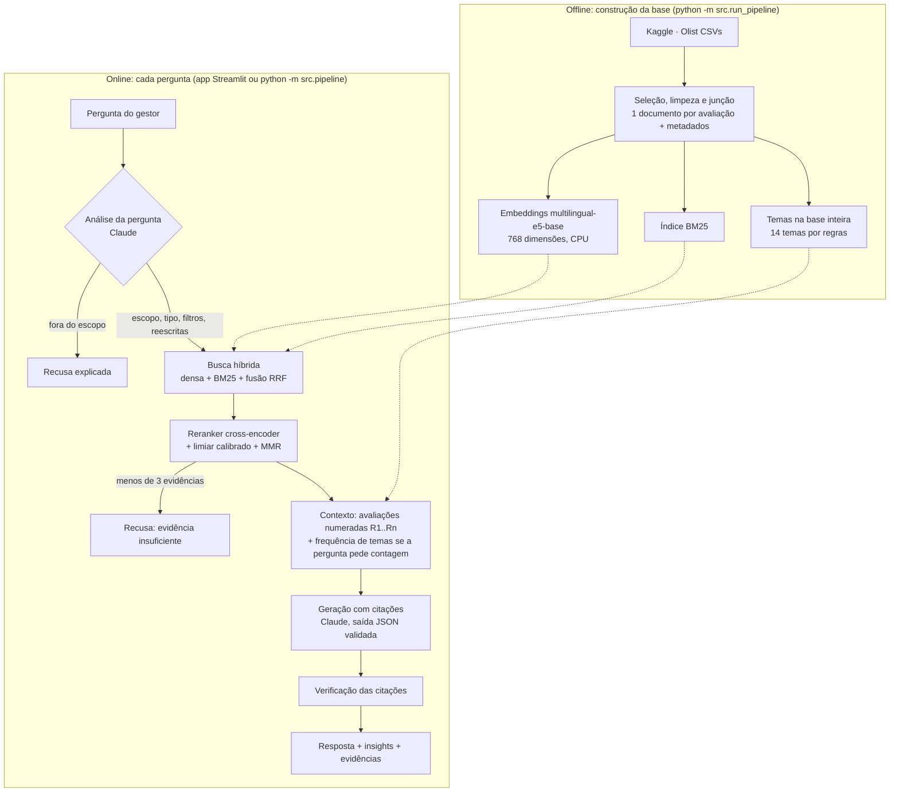
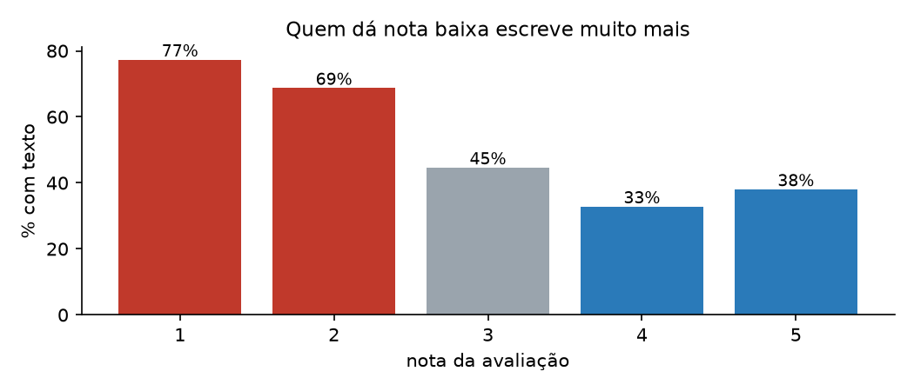
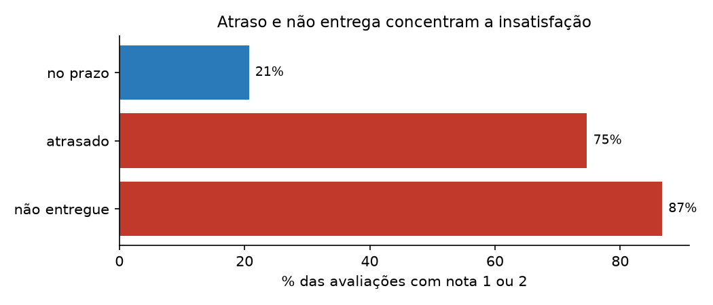
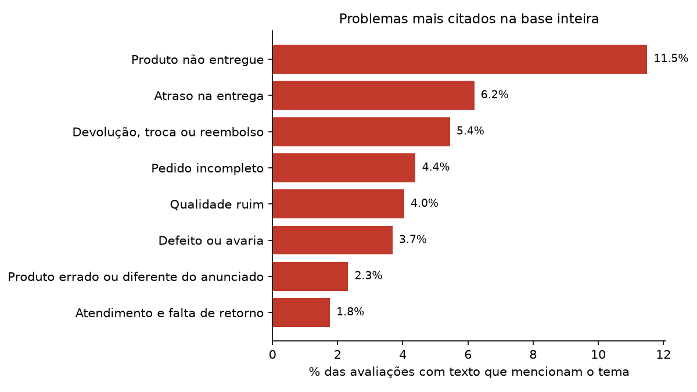
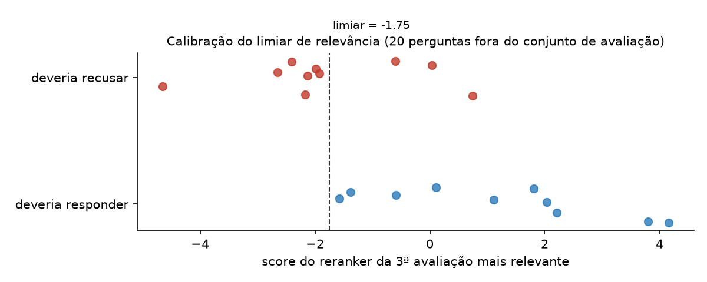

# Voz do Cliente: RAG sobre avaliações da Olist

Gestores perguntam em linguagem natural ("quais reclamações de entrega aparecem com maior frequência?") e recebem uma resposta **fundamentada nas avaliações reais dos clientes**, com cada afirmação apontando as avaliações que a sustentam. Quando a base não tem evidência suficiente, ou a pergunta está fora do escopo, o sistema diz isso em vez de inventar.

Tech Challenge da Fase 4 da pós em IA (FIAP). Base: [Brazilian E-Commerce Public Dataset by Olist](https://www.kaggle.com/datasets/olistbr/brazilian-ecommerce), cerca de 100 mil pedidos de 2016 a 2018.

**Resultados principais**

- **36.038 avaliações** viram documentos pesquisáveis, cada uma com nota, período, categoria e status da entrega.
- **Recusa honesta (modo sem LLM):** recusa 100% das perguntas fora do escopo e sem evidência; responde 90% das que deveria responder (27 de 30). Detalhes na [seção 9](#9-avaliação).
- **Frequência de verdade:** "principais problemas" é contado nas 36 mil avaliações, não nas 15 recuperadas. Com nota 1 ou 2, *produto não entregue* aparece em 32,6% dos textos.
- Roda em CPU, sem GPU e sem conta no Kaggle. A chave da Anthropic só é necessária para a resposta gerada.
<!-- RESULTADOS_LLM: métricas de recuperação e fidelidade entram após a execução com chave -->

| | |
|---|---|
| Vídeo de apresentação (até 7 min) | _link após a gravação_ |
| Notebooks | [01 · Exploração das avaliações](notebooks/01_exploracao_avaliacoes.ipynb) · [02 · Pipeline RAG passo a passo](notebooks/02_pipeline_rag_passo_a_passo.ipynb) |
| Exemplos de perguntas e respostas | [seção 10](#10-exemplos-de-perguntas-e-respostas) |
| Avaliação | [seção 9](#9-avaliação) · [conjunto de perguntas](src/evaluation/perguntas.yaml) |
| Funil da base | [`reports/funil.json`](reports/funil.json) |

---

## 1. Problema de negócio

Um e-commerce recebe milhares de avaliações. A nota (1 a 5) mostra **se** o cliente ficou satisfeito; o comentário mostra **por quê**. Ler milhares de comentários à mão não escala, e os gestores precisam responder perguntas como:

- Quais são os principais problemas relatados pelos clientes?
- Quais reclamações de entrega aparecem com maior frequência?
- O que os clientes mais elogiam?
- Quais avaliações sustentam um determinado insight?

A solução transforma os comentários numa base de conhecimento consultável. A resposta precisa ser **rastreável** (de onde veio cada afirmação) e **honesta** (sem resposta convincente quando não há dado).

Na Fase 1 a turma trabalhou com os números do NPS de um e-commerce: quais fatores operacionais derrubam a satisfação. Aqui o mesmo problema é olhado pelo texto, que explica o que os números só apontam.

## 2. Arquitetura



| Etapa do enunciado | Onde acontece | Arquivo |
|---|---|---|
| Processamento da pergunta | Escopo, tipo, filtros e reescritas | [`analise_pergunta.py`](src/retrieval/analise_pergunta.py) |
| Representação vetorial | `multilingual-e5-base`, prefixos `query:` / `passage:` | [`embeddings.py`](src/indexing/embeddings.py) |
| Recuperação das avaliações | Densa + BM25 com fusão RRF, pré-filtro de metadados | [`busca.py`](src/retrieval/busca.py) · [`filtros.py`](src/retrieval/filtros.py) |
| Seleção dos mais relevantes | Reranker, limiar calibrado, MMR, deduplicação | [`busca.py`](src/retrieval/busca.py) |
| Construção do contexto | Avaliações numeradas + tabela de temas | [`resposta.py`](src/generation/resposta.py) |
| Geração da resposta | Claude com saída estruturada e citações | [`resposta.py`](src/generation/resposta.py) · [`llm.py`](src/generation/llm.py) |
| Resposta fundamentada | Verificação das citações; recusa sem evidência | [`pipeline.py`](src/pipeline.py) |

## 3. Tecnologias e bibliotecas

| Componente | Escolha | Por quê |
|---|---|---|
| Linguagem | Python 3.11 | Ecossistema de NLP; padrão das fases anteriores |
| Embeddings | [`intfloat/multilingual-e5-base`](https://huggingface.co/intfloat/multilingual-e5-base) (sentence-transformers) | Multilíngue com bom desempenho em português, roda em CPU sem chave: qualquer pessoa reconstrói o índice |
| Busca por palavra-chave | BM25 ([`rank-bm25`](https://github.com/dorianbrown/rank_bm25)) | Cobre termos exatos que o embedding dilui ("correios", "nota fiscal", "cartucho") |
| Fusão | Reciprocal Rank Fusion | Combina rankings pela posição, sem calibrar escalas diferentes (cosseno × BM25) |
| Reranker | [`cross-encoder/mmarco-mMiniLMv2-L12-H384-v1`](https://huggingface.co/cross-encoder/mmarco-mMiniLMv2-L12-H384-v1) | Multilíngue (treinado no mMARCO, que inclui português), pequeno o bastante para CPU |
| Armazenamento vetorial | Matriz numpy + Parquet | Ver [decisão D3](#11-decisões-técnicas) |
| LLM | Claude Opus 5.5 (`claude-opus-5-5`, API da Anthropic) | Qualidade em português, saída JSON validada por esquema, segue regras de citação |
| Interface | Streamlit | Mostra resposta, evidências e cada etapa do pipeline |
| Dados | pandas, pyarrow, kagglehub | Download sem chave, Parquet para a base |
| Qualidade | pytest, GitHub Actions | Testes e reconstrução da base a cada pull request |

## 4. Preparação da base

### 4.1 O que os dados mostraram

Detalhes e gráficos no [notebook 01](notebooks/01_exploracao_avaliacoes.ipynb).

| Nota | % das avaliações com título ou comentário |
|---|---|
| 1 | 77,3% |
| 2 | 68,7% |
| 3 | 44,6% |
| 4 | 32,8% |
| 5 | 38,0% |
| **Total** | **43,0%** |



Quem dá nota baixa escreve muito mais. A base de texto pende para a insatisfação, então cada contagem informa sobre qual universo foi feita (limitação 1, seção 12).



Atraso e não entrega concentram as notas baixas: por isso o status da entrega virou metadado filtrável.

### 4.2 Funil: de 99.224 avaliações a 36.038 documentos

| Etapa | Ficam | Saem | Motivo |
|---|---|---|---|
| Avaliações na base | 99.224 | | 98.410 `review_id` distintos |
| **Seleção:** tem título ou comentário | 42.687 | 56.537 | Só nota, sem texto. Não entram na base de texto; a nota segue nas estatísticas |
| **Organização:** um documento por `review_id` | 42.370 | 317 | O mesmo `review_id` aparece em até 3 pedidos com o mesmo texto. Contar uma vez evita inflar frequências; `n_pedidos` guarda quantos eram |
| **Informatividade:** pelo menos 3 palavras | **36.038** | 6.332 | "muito bom" (446), "bom" (377), "recomendo" (343): não explicam o porquê da nota |

Detalhe com exemplos em [`reports/funil.json`](reports/funil.json).

### 4.3 Limpeza

| Problema | Tratamento |
|---|---|
| Quebras de linha `\r\n` dentro do comentário | Viram espaço |
| Espaços repetidos, unicode em formas diferentes | Normalização NFC e espaços colapsados |
| Título e comentário separados | Um texto só: título, ponto e comentário. O título costuma resumir a avaliação ("Péssimo") |
| Acento e caixa variam ("Não recebi", "nao recebi", "NÃO RECEBI") | Duas versões: `texto` (original limpo, para leitura e embedding, porque caixa e pontuação carregam sentido) e `texto_busca` (sem acento, minúsculo, para BM25 e temas) |
| Textos idênticos de clientes diferentes | Ficam na base (cada um é um cliente), mas contam uma vez como evidência na resposta |

**Stopwords:** lista própria e curta. "não", "nada", "nunca" e "sem" **não** são removidas: "não recebi" e "recebi" são o oposto.

### 4.4 Valores ausentes

| Campo | Ausentes | Tratamento |
|---|---|---|
| Título e comentário | 56.537 sem nenhum dos dois | Fora da base de texto (seção 4.2) |
| Só título, sem comentário | 1.729 | O título vira o texto, se tiver 3 palavras ou mais |
| Data de entrega ao cliente | 1.764 documentos | `status_entrega = nao_entregue`; `atraso_dias` fica nulo em vez de zero, para não fingir pontualidade |
| Categoria do produto | Pedidos sem itens ou produto sem categoria | `sem categoria`, explícita no filtro |

### 4.5 Organização dos documentos

Cada avaliação é **um documento inteiro, sem chunking**: nenhum comentário passa de 208 caracteres (mediana de 10 palavras). Dividir não ajudaria a busca e quebraria a citação: cada [Rn] aponta uma avaliação exata, com `review_id`.

| Campo | Uso |
|---|---|
| `review_id`, `order_id` | Rastreabilidade |
| `texto`, `texto_busca` | Embedding e leitura; BM25 e temas |
| `nota` | Filtro e contexto |
| `data_compra`, `data_avaliacao` | Filtro de período |
| `categoria` (item mais caro), `categorias` (todas do pedido) | Contexto; filtro (qualquer categoria do pedido) |
| `status_entrega`, `atraso_dias`, `prazo_dias` | Filtro e contexto |
| `uf_cliente`, `valor_pedido`, `frete`, `n_itens` | Contexto e análises |

### 4.6 Embeddings e indexação

- 36.038 vetores de 768 dimensões, normalizados, em `data/index/embeddings.npy`, na mesma ordem das linhas de `data/processed/documentos.parquet`.
- Prefixo `passage:` nos documentos e `query:` nas perguntas, como o modelo E5 foi treinado.
- O índice guarda o hash da base e o nome do modelo: se a base mudar, ele é refeito.
- BM25 construído em memória ao carregar.

| Medida | Valor (CPU, notebook comum) |
|---|---|
| Tempo para gerar os 36.038 embeddings | 28 min (uma vez; refeito só se a base mudar) |
| Tamanho do índice | 110,7 MB |
| Busca + reranking de uma pergunta exploratória | ~1,3 s |
| Pergunta de frequência (busca + temas + exemplos) | ~2,4 s |

Os tempos de consulta foram medidos com os modelos já carregados e não incluem a chamada ao Claude.

## 5. Estratégia do pipeline RAG

### 5.1 Transformação da pergunta

O Claude lê a pergunta e devolve, em JSON validado por esquema:

| Saída | Para quê | Exemplo |
|---|---|---|
| `no_escopo` | Pergunta fora do que as avaliações contêm nem chega na busca | "faturamento da Olist" → fora |
| `tipo` | Muda a estratégia | `frequencia` → aciona a contagem de temas |
| `tipo_tema` | Foco em problema ou elogio | "o que mais elogiam" → `elogio` |
| `filtros` | Pré-filtro de metadados | "nota baixa" → nota 1 a 2 |
| `consultas` | 2 ou 3 reescritas no vocabulário do cliente | "problemas de entrega" → "não recebi meu pedido até hoje", "chegou muito atrasado" |

As reescritas existem porque o gestor e o cliente usam palavras diferentes para a mesma coisa. A pergunta original continua sendo a primeira consulta.

### 5.2 Recuperação semântica

Para cada consulta: busca densa (cosseno exato contra os 36 mil vetores) e BM25, cada uma com 100 candidatos, **só dentro dos documentos que passam no filtro**. Filtrar antes garante que uma pergunta sobre uma categoria pequena não volte vazia. As listas de todas as consultas são fundidas por RRF.

### 5.3 Seleção dos conteúdos mais relevantes

1. **Deduplicação:** textos idênticos contam uma vez.
2. **Reranking:** os 60 primeiros da fusão passam pelo cross-encoder, que lê pergunta e avaliação juntas. O cross-encoder recebe o **núcleo** da pergunta ("a nota fiscal"), e não o enunciado inteiro ("O que os clientes falam sobre a nota fiscal?"). Avaliações são curtas e não repetem a moldura "o que os clientes relatam sobre", e o enunciado inteiro derrubava o score de avaliações claramente relevantes: "Faltou a nota fiscal" ficava em −3,3 ([`nucleo.py`](src/retrieval/nucleo.py)).
3. **Limiar de relevância:** só conta como evidência quem passa do limiar calibrado (seção 7).
4. **MMR:** escolhe 15 avaliações equilibrando relevância (70%) e diversidade (30%), para o contexto não ser 15 variações de "chegou atrasado".

### 5.4 Perguntas de frequência

"Quais problemas aparecem com maior frequência?" é uma pergunta de **contagem**. As 15 avaliações recuperadas foram escolhidas por relevância, não são amostra: contar temas nelas inventaria a frequência.

Por isso a base inteira é classificada em 14 temas (8 de problema, 2 neutros, 4 de elogio) por regras de texto auditáveis ([`temas.py`](src/temas/temas.py)). Numa pergunta de frequência:

- a **contagem** vem da base inteira com os filtros da pergunta;
- as **evidências** são as recuperadas pela busca + 3 exemplos de cada um dos 5 temas mais frequentes;
- o prompt proíbe qualquer número que não venha da tabela.



### 5.5 Construção do contexto

Exemplo real (pergunta sobre problemas nas avaliações com nota baixa):

```
Pergunta do gestor: Quais são os principais problemas relatados nas avaliações com nota baixa?
Filtros aplicados: nota 1 a 2

Frequência de temas na base (universo: 10543 avaliações com texto após filtros):
- Produto não entregue (problema): 3437 avaliações (32.6%)
- Devolução, troca ou reembolso (problema): 1543 avaliações (14.6%)
- Atraso na entrega (problema): 1416 avaliações (13.4%)
- ...

Avaliações recuperadas:
[R1] nota 1 | cama mesa banho | não entregue | compra 2017-08-15
"Tive problemas sérios com a troca de local de entrega e meu produto nunca chegou, cancelei a minha compra e dificilmente volto a comprar"
...
```

### 5.6 Geração e verificação

O Claude responde em JSON com `resposta` (texto com [Rn]), `insights` (cada um com as avaliações que o sustentam), `suficiente` e `lacunas`. Regras do prompt ([`resposta.py`](src/generation/resposta.py)): só o contexto, citação em cada afirmação, números só da tabela de temas, dizer quando a evidência não basta.

Depois da geração, o código confere cada citação: [Rn] que não existe no contexto é removido e contado como citação inválida (métrica na seção 9).

## 6. Respostas fundamentadas em evidências

Cada resposta traz:

1. o texto com citações [R1][R4] após cada afirmação;
2. os insights, cada um com a lista das avaliações que o sustentam;
3. a tabela das avaliações recuperadas com `review_id`, nota, categoria, entrega e score do reranker;
4. nas perguntas de frequência, a contagem de temas e o universo sobre o qual ela foi feita.

No app, cada insight abre e mostra as avaliações citadas. O painel "Por dentro do pipeline" mostra filtros, reescritas, candidatos por etapa e o contexto exato enviado ao modelo.

## 7. Perguntas sem evidência suficiente

Três barreiras, em ordem:

| Situação | Barreira | Resposta |
|---|---|---|
| Pergunta fora do escopo ("capital da Austrália", "faturamento") | O Claude marca `no_escopo = false` antes da busca | Recusa com o motivo |
| Nenhuma avaliação relevante ("entregas por drone") | Menos de 3 avaliações acima do limiar do reranker | Recusa **sem chamar o LLM de geração**: o modelo não tem chance de improvisar |
| Pergunta de frequência com filtros que deixam poucas avaliações | Universo filtrado com menos de 30 avaliações com texto | Recusa: um percentual sobre 20 avaliações muda 5 pontos com cada uma |
| Evidência parcial | O prompt manda marcar `suficiente = false` e explicar em `lacunas` | Resposta com ressalva explícita |

Perguntas de frequência ("quais os principais problemas?") não passam pelo limiar do reranker: elas não têm um assunto único para ele medir. A resposta vem da contagem de temas no universo filtrado, e as evidências são exemplos de cada tema.

**Calibração do limiar.** O limiar foi escolhido num conjunto **separado** de 20 perguntas (10 que devem ser respondidas, 10 que devem ser recusadas), diferente do conjunto de avaliação. Assim a taxa de recusa da seção 9 não é medida com as mesmas perguntas que escolheram o limiar.

Regra: responde se pelo menos 3 avaliações têm score do reranker acima do limiar. O limiar varre de −6 a 8 e fica o que maximiza a acurácia balanceada.

| | Resultado |
|---|---|
| Limiar escolhido | **−1,75** (logit do cross-encoder) |
| Acurácia balanceada na calibração | 0,85 |
| Perguntas "responder" acima do limiar | 10 de 10 |
| Perguntas "recusar" abaixo do limiar | 7 de 10 |



As três que o limiar sozinho não recusa: "salário médio de um entregador", "traduza bom dia" e "restaurante da loja". As duas primeiras estão fora do escopo e são barradas antes, pela análise da pergunta com o Claude; a terceira é um caso em que a recusa depende do modelo marcar `suficiente = false`. A pergunta "responder" de menor score (tamanho das roupas, −1,58) ficou perto do limiar: as duas classes se sobrepõem, e o limiar não separa tudo sozinho. Por isso são três barreiras, não uma. Dados por pergunta em [`reports/calibracao_limiar.json`](reports/calibracao_limiar.json).

**Uma correção feita durante o desenvolvimento.** Na primeira versão, o reranker comparava o enunciado inteiro com as avaliações. Com ela, o sistema sem LLM recusava 53% das perguntas que deveria responder no conjunto de avaliação, inclusive perguntas do enunciado. Duas mudanças: o reranker passou a usar o núcleo da pergunta, e perguntas de frequência passaram a depender da contagem de temas (acima). O limiar foi recalibrado **só** no conjunto de calibração. A mudança foi motivada pelo resultado no conjunto de avaliação, e registramos isso aqui porque deixa a medida da seção 9 um pouco otimista.

## 8. Desafio adicional: metadados

| Metadado | Origem | Pergunta que ele habilita |
|---|---|---|
| Nota | `review_score` | "Problemas nas avaliações com nota baixa" |
| Período | `order_purchase_timestamp` | "Reclamações sobre compras de novembro de 2017" |
| Categoria | itens do pedido → produto → categoria | "O que elogiam em cama, mesa e banho" |
| Entrega | data real × data estimada de entrega | "Temas em entregas insatisfatórias" |

**Como os metadados melhoram a recuperação:**

1. **Precisão:** sem filtro, "problemas em cama, mesa e banho" traz reclamações parecidas de qualquer categoria. A busca semântica não sabe a categoria de um comentário como "veio manchado"; o metadado sabe.
2. **Contagem correta:** a frequência de temas é calculada no universo filtrado. "Principais problemas com nota baixa" conta só entre as 10.543 avaliações nota 1 e 2.
3. **Contexto para o modelo:** cada evidência leva nota, categoria e status da entrega, então o modelo distingue "reclamou de atraso e deu nota 5" de "reclamou de atraso e deu nota 1".
4. **Pré-filtro, não pós-filtro:** filtrar depois da busca faria perguntas sobre categorias pequenas voltarem quase vazias.

**Medido.** Pergunta "O que os clientes relatam sobre entrega atrasada?":

| | Evidências que são de fato entregas atrasadas |
|---|---|
| Sem filtro (só a busca semântica) | 11 de 15 |
| Com filtro `status_entrega = atrasado` | 15 de 15 |

Sem o filtro, entram avaliações que *falam* de atraso mas cujo pedido consta como entregue dentro da data estimada. O texto diz o que o cliente sentiu; o metadado diz o que aconteceu, e a pergunta pode escolher qual dos dois quer.

O filtro também muda a resposta de frequência, porque o universo muda:

| Universo | Avaliações com texto | 3 problemas mais citados |
|---|---|---|
| Base inteira | 36.038 | Não entregue 11,5% · Atraso 6,2% · Devolução/reembolso 5,4% |
| Nota 1 a 2 | 10.543 | Não entregue 32,6% · Devolução/reembolso 14,6% · Atraso 13,4% |
| Entrega atrasada ou não entregue | 5.343 | Não entregue 47,1% · Atraso 23,3% · Devolução/reembolso 12,4% |
| Categoria cama, mesa e banho | 3.682 | Não entregue 11,7% · Qualidade ruim 7,2% · Pedido incompleto 6,2% |

Na categoria cama, mesa e banho, *qualidade ruim* sobe para o segundo lugar, o que não aparece na base inteira.

## 9. Avaliação

O enunciado avalia principalmente **recuperar bem** e **responder coerente com as evidências**. As duas coisas são medidas com números, num conjunto de 41 perguntas escrito antes de ajustar o sistema ([`perguntas.yaml`](src/evaluation/perguntas.yaml)):

| Grupo | Perguntas | Esperado |
|---|---|---|
| Enunciado (todas as perguntas do PDF) | 9 | Responder |
| Metadados | 7 | Responder |
| Temas específicos | 14 | Responder |
| Evidência insuficiente (drone, cashback, criptomoeda...) | 5 | Recusar |
| Fora do escopo | 6 | Recusar |

### 9.1 Recusa: o sistema sabe quando não sabe?

Modo sem LLM (análise da pergunta por regras, sem decisão de escopo). Arquivo: [`reports/avaliacao_sem_llm.json`](reports/avaliacao_sem_llm.json).

| Métrica | Resultado |
|---|---|
| Responde quando deve (30 perguntas) | **90%** (27) |
| Recusa fora do escopo (6) | **100%** |
| Recusa sem evidência suficiente (5) | **100%** |

As 3 recusas indevidas: E09 ("Quais avaliações sustentam a conclusão de que existem problemas recorrentes relacionados ao prazo de entrega?"), T12 (relógios) e T14 (cobrança indevida). Nas três, menos de 3 avaliações passaram do limiar.

Sem LLM, as perguntas fora do escopo são recusadas só pelo limiar: nenhuma avaliação fala de "capital da Austrália". Com o Claude, a análise de escopo barra essas perguntas antes da busca.

<!-- AVALIACAO_LLM: 9.2 recuperação (precision@10, nDCG@10 por configuração), 9.3 fidelidade, 9.4 validação dos temas -->
_As métricas de recuperação (precision@10 e nDCG@10 com juiz LLM, comparando busca densa, híbrida e híbrida com reranker), de fidelidade das respostas e de validação dos temas são geradas por `python -m src.evaluation.avaliar --juiz` e `python -m src.evaluation.avaliar_temas --llm`, que precisam da chave da API._

## 10. Exemplos de perguntas e respostas

<!-- EXEMPLOS_LLM: gerados em reports/exemplos_respostas.json -->
_Os exemplos com resposta gerada entram aqui após a execução com a chave da API. Sem a chave, o [notebook 02](notebooks/02_pipeline_rag_passo_a_passo.ipynb) mostra cada etapa com saídas reais, até o contexto enviado ao modelo._

## 11. Decisões técnicas

| # | Decisão | Alternativas | Por quê |
|---|---|---|---|
| D1 | Um documento por avaliação, sem chunking | Chunks de N tokens | Comentários de até 208 caracteres; a citação aponta a avaliação exata |
| D2 | Embeddings locais (`multilingual-e5-base`) | Embeddings por API | Português, custo zero, reprodutível sem chave |
| D3 | Busca exata em numpy em vez de banco vetorial | Chroma, pgvector, FAISS-HNSW | Com 36 mil vetores, a busca exata leva milissegundos, não perde vizinhos (índices aproximados perdem) e combina direto com o filtro do pandas. [`indice.py`](src/retrieval/indice.py) isola a escolha: trocar por um banco vetorial muda um arquivo. Com milhões de vetores, a troca passa a valer |
| D4 | Busca híbrida (densa + BM25) com RRF | Só densa | Termos exatos ("correios", "nota fiscal") e sentido parecido com outras palavras se complementam; RRF dispensa calibrar escalas |
| D5 | Reranker cross-encoder | Só similaridade de vetores | Lê pergunta e avaliação juntas; dá um score que serve de limiar para recusar |
| D6 | Pré-filtro de metadados | Pós-filtro | Pergunta sobre categoria pequena não volta vazia |
| D7 | Temas por regras na base inteira para frequência | Contar nas recuperadas; LLM classificando 36 mil avaliações | Contar nas recuperadas é estatisticamente errado; LLM na base inteira custaria dezenas de dólares por execução. Regras são auditáveis e validadas (seção 9) |
| D8 | Limiar calibrado em conjunto separado | Limiar fixo escolhido no olho | A taxa de recusa medida não fica otimista |
| D9 | Recusa sem chamar o LLM quando falta evidência | Deixar o modelo decidir | O modelo não tem chance de improvisar sobre evidência fraca |
| D10 | Saída JSON por esquema + verificação de citações | Texto livre | Insight e evidência ficam ligados; citação inventada é detectada |
| D11 | Claude Opus 5.5 com `fallbacks: "default"` | Outros provedores, modelo local | Qualidade em português e em seguir regras de citação; o fallback evita erro se o classificador de segurança recusar |
| D12 | Orquestração em código próprio | LangChain, LlamaIndex | Cada etapa visível e testável, como o enunciado pede ("demonstrar como ocorre") |
| D13 | Modo "só recuperação" sem chave | Exigir chave | Quem avalia sem chave ainda vê a busca e as evidências funcionando |

## 12. Limitações

1. **Base de texto enviesada para a insatisfação.** A nota 1 tem texto muito mais vezes que a nota 5 ([notebook 01](notebooks/01_exploracao_avaliacoes.ipynb)). Percentuais sobre avaliações com texto não representam todos os clientes; o sistema sempre informa o universo.
2. **Temas por regras.** São transparentes, mas perdem formas de escrever fora do dicionário e erram em ironia. A qualidade medida está na seção 9.
3. **Juiz e gerador são o mesmo modelo.** Pode favorecer o próprio estilo. Uma amostra dos julgamentos fica em `reports/julgamentos_para_revisar.csv` para revisão humana.
4. **Conjunto de avaliação pequeno** (41 perguntas). Suficiente para comparar configurações, não para cravar uma taxa com precisão de uma casa decimal.
5. **Dados de 2016 a 2018.** Os padrões descrevem aquele período.
6. **O reranker não entende bem negação.** Para "problemas relacionados à entrega", ele pontua alto "Produto entregue sem problemas" (exemplo no notebook 02, etapa 4). O MMR e o prompt de geração reduzem o efeito, mas a evidência pode vir com ruído.
7. **Avaliação antes da entrega.** Parte das avaliações foi escrita antes de o produto chegar ("ainda não recebi"), o que infla o tema "não entregue" em relação às entregas que de fato falharam.

## 13. Como reproduzir

Requisitos: Python 3.11 e cerca de 2 GB livres (modelos e índice). Não precisa de GPU nem de conta no Kaggle.

```bash
git clone https://github.com/leonardoaz98/tech-challenge-fase4.git
cd tech-challenge-fase4
python -m venv .venv && source .venv/bin/activate      # Windows: .venv\Scripts\activate
pip install -r requirements.txt

cp .env.example .env        # e preencha ANTHROPIC_API_KEY (opcional, ver abaixo)

python -m src.run_pipeline           # baixa a base, monta documentos, temas, índice, calibra e avalia
streamlit run app/streamlit_app.py   # interface
python -m src.pipeline "Quais são os principais problemas relatados pelos clientes?"   # terminal
```

| Etapa | Comando isolado | Precisa de chave? |
|---|---|---|
| Download da base | `python -m src.ingestion.baixar_dados` | Não |
| Base de conhecimento | `python -m src.preprocessing.base_conhecimento` | Não |
| Temas | `python -m src.temas.temas` | Não |
| Índice vetorial | `python -m src.indexing.indexar` | Não |
| Calibração do limiar | `python -m src.evaluation.calibrar_limiar` | Não |
| Avaliação de recusa | `python -m src.evaluation.avaliar` | Não (com chave, usa o LLM) |
| Avaliação de recuperação e fidelidade | `python -m src.evaluation.avaliar --juiz` | Sim |
| Validação dos temas | `python -m src.evaluation.avaliar_temas --llm` | Sim |

**Sem chave da Anthropic** o sistema roda em modo "só recuperação": análise da pergunta por regras, busca, limiar e evidências, sem a resposta gerada.

<!-- CUSTO -->

## 14. Estrutura do repositório

```
tech-challenge-fase4/
├── app/streamlit_app.py            # interface
├── src/
│   ├── config.py                   # caminhos, modelos e parâmetros (um lugar só)
│   ├── ingestion/baixar_dados.py   # Kaggle -> data/raw
│   ├── preprocessing/              # limpeza e base de conhecimento (+ funil)
│   ├── temas/temas.py              # 14 temas na base inteira
│   ├── indexing/                   # embeddings e índice vetorial
│   ├── retrieval/                  # análise da pergunta, filtros, busca híbrida, reranking
│   ├── generation/                 # LLM, contexto, resposta, verificação de citações
│   ├── evaluation/                 # perguntas, calibração, métricas, validação dos temas
│   ├── pipeline.py                 # RAG de ponta a ponta
│   ├── run_pipeline.py             # reconstrói tudo do zero
│   └── checar_resultados.py        # funil e temas x referência (CI)
├── notebooks/                      # 01 exploração · 02 pipeline passo a passo
├── reports/                        # funil, temas, calibração, avaliação
├── images/                         # gráficos do README
├── tests/                          # testes de unidade
├── data/                           # gerado pelo pipeline (fora do git)
└── .github/                        # CI e modelo de pull request
```

## 15. Checklist do enunciado

| Requisito | Onde |
|---|---|
| Seleção, limpeza, ausentes, organização dos documentos | Seções 4.2 a 4.5 · [`base_conhecimento.py`](src/preprocessing/base_conhecimento.py) |
| Criação dos embeddings, armazenamento e indexação | Seção 4.6 · [`indexing/`](src/indexing) |
| Transformação da pergunta | Seção 5.1 · notebook 02, etapa 1 |
| Recuperação semântica | Seção 5.2 · notebook 02, etapas 2 e 3 |
| Seleção dos mais relevantes | Seção 5.3 · notebook 02, etapa 4 |
| Construção do contexto | Seção 5.5 · notebook 02, etapa 5 |
| Geração da resposta | Seção 5.6 · notebook 02, etapa 5 |
| Respostas com evidências e rastreabilidade | Seção 6 · app |
| Sem avaliações relevantes / evidência insuficiente / fora do escopo | Seção 7 · métricas na seção 9 |
| Desafio adicional: metadados, com justificativa | Seção 8 |
| Código-fonte, instalação e execução | [`src/`](src) · seção 13 |
| Arquitetura, tecnologias, estratégia RAG, preparação da base | Seções 2 a 5 |
| Justificativa das decisões técnicas | Seção 11 |
| Exemplos de perguntas e respostas | Seção 10 |
| Informações para reproduzir | Seção 13 |
| Vídeo de até 7 minutos | Link no topo |

## Organização do trabalho

O fluxo está em [`CONTRIBUTING.md`](CONTRIBUTING.md): uma branch por etapa, pull request com modelo, CI obrigatório e revisão do grupo antes do merge.

## Autores

<!-- AUTORES -->
_A preencher pelo grupo._

## Fontes

- Olist. *Brazilian E-Commerce Public Dataset by Olist*. Kaggle. https://www.kaggle.com/datasets/olistbr/brazilian-ecommerce
- Wang, L. et al. *Multilingual E5 Text Embeddings: A Technical Report*. 2024.
- Cormack, G., Clarke, C., Büttcher, S. *Reciprocal Rank Fusion outperforms Condorcet and individual Rank Learning Methods*. SIGIR 2009.
- Carbonell, J., Goldstein, J. *The use of MMR, diversity-based reranking for reordering documents and producing summaries*. SIGIR 1998.
- Bonifacio, L. et al. *mMARCO: A Multilingual Version of the MS MARCO Passage Ranking Dataset*. 2021.
